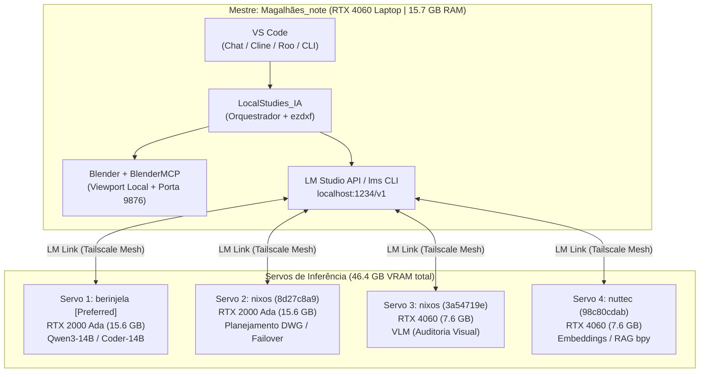
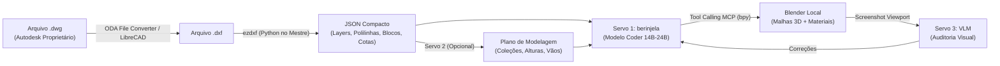
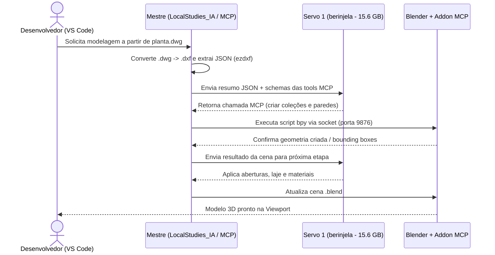
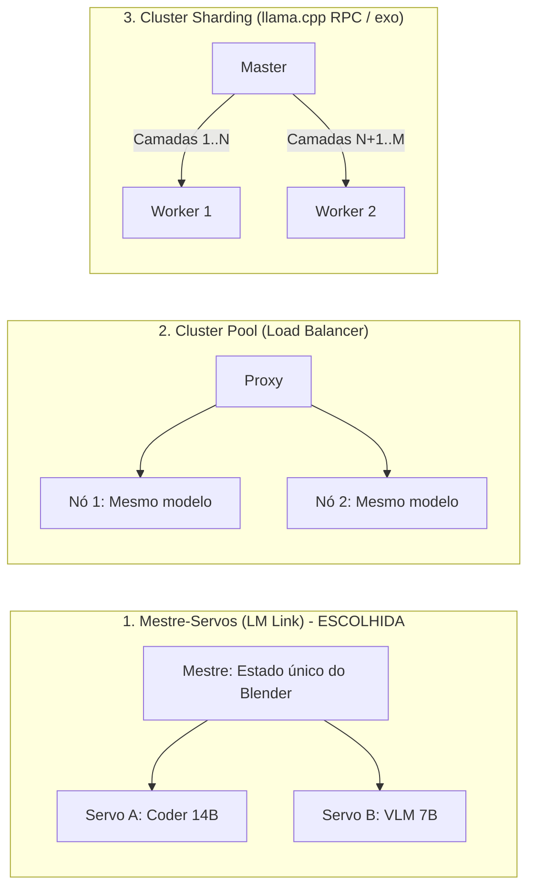

# Arquitetura e Engenharia — LocalStudies_IA

Documentação técnica da infraestrutura **Mestre e Servos via LM Link**, integração com **Blender + MCP** no **VS Code**, e pipeline de modelagem 3D a partir de arquivos **DWG**.

---

## 1. Inventário de Hardware (Rede LM Link)

Rede mesh criptografada via **LM Link (Tailscale)** com **1 Mestre (Workstation)** e **4 Servos de Inferência** conectados (**46,4 GB de VRAM** e **123,8 GB de RAM** somados nos servos, além da estação Mestre).

| Papel | Dispositivo | Device ID (LM Link) | GPU | VRAM | RAM | Função na Arquitetura |
| :--- | :--- | :--- | :--- | :--- | :--- | :--- |
| **Mestre** | `Magalhães_note` *(local)* | — | RTX 4060 Laptop | ~8.0 GB | 15.7 GB | **VS Code**, **Blender + MCP**, conversão `.dwg`→`.dxf`, extração `ezdxf` e coordenação da cena. |
| **Servo 1** *(Preferred)* | `berinjela` | `c9d558e8a7f1ab7610cba197267c4d38` | NVIDIA RTX 2000 Ada | **15.6 GB** | 30.8 GB | **Modelagem / Código `bpy` e Tool Calling** (modelos 14B–24B Q4_K_M/Q5_K_M, contexto 16k–32k). |
| **Servo 2** | `nixos` *(Ada)* | `8d27c8a9351745605bfede9f7cd6dc07` | NVIDIA RTX 2000 Ada | **15.6 GB** | 31.0 GB | **Arquiteto DWG / Planejamento** ou **Failover / Réplica** do Servo 1 para tarefas paralelas. |
| **Servo 3** | `nixos` *(4060)* | `3a54719e8256bdd028946faa0a585341` | NVIDIA GeForce RTX 4060 | **7.6 GB** | 31.0 GB | **Visão (VLM)** para auditar screenshots da viewport do Blender e plantas 2D (7B Q4). |
| **Servo 4** | `nuttec` | `98c80cdab4b745a990b39b3c7662ff27` | NVIDIA GeForce RTX 4060 | **7.6 GB** | 31.0 GB | **Embeddings / RAG** (documentação `bpy`, catálogos de materiais/blocos) e tarefas rápidas (3B–7B). |

> **Recomendação operacional:** Como há dois nós chamados `nixos`, recomenda-se renomear um deles via CLI para evitar ambiguidade:
> ```powershell
> lms link set-device-name nixos-ada   # na máquina com RTX 2000 Ada
> lms link set-device-name nixos-4060  # na máquina com RTX 4060
> ```

---

## 2. Diagramas de Arquitetura (Mermaid)

### 2.1 Topologia Mestre e Servos via LM Link



### 2.2 Pipeline DWG → Modelagem 3D no Blender



### 2.3 Sequência de Execução Interativa (VS Code → LM Link → Blender)



---

## 3. Decisões de Engenharia e Trade-offs

### 3.1 Mestre-Servos (LM Link) vs. Cluster Pool vs. Cluster Sharding

> **Fato técnico sobre o LM Link:** O LM Link conecta nós via rede mesh (Tailscale) para **roteamento remoto de inferência**. Ele **não** faz *model sharding* (dividir camadas de um único modelo entre GPUs de máquinas diferentes).



| Critério | Mestre e Servos (LM Link) | Cluster Pool / LB (LM Link) | Cluster Sharding (`llama.cpp` RPC / `exo`) |
| :--- | :--- | :--- | :--- |
| **Suporte nativo LM Link** | Sim | Parcial (exige proxy/roteador) | Não |
| **Tamanho máximo de modelo** | Maior GPU individual (15.6 GB) | Menor GPU do pool | Soma das GPUs (até 46.4 GB) |
| **Latência por token** | **Baixa** (1 salto de rede) | Baixa | **Alta** (sincronização por camada via rede) |
| **Sinergia com Blender MCP** | **Excelente** (libera GPU local e evita race conditions) | Baixa (cena do Blender é single-state) | Média/Baixa (lento para tool-calling iterativo) |
| **Complexidade** | Baixa | Média | Alta |

#### Pontos Fortes e Fracos da Escolha (Mestre-Servos)
* **Pontos Fortes:**
  * Preserva a **RTX 4060 Laptop** e os **15.7 GB de RAM** do Mestre 100% livres para o Blender (Viewport/Cycles/Eevee) e VS Code.
  * Permite usar modelos **14B–24B** nas duas **RTX 2000 Ada (15.6 GB)** sem estourar memória, enquanto as duas **RTX 4060 (7.6 GB)** ficam dedicadas a Visão (VLM) e Embeddings/RAG.
  * Baixa latência para loops iterativos de *tool calling* no `blender-mcp`.
* **Pontos Fracos:**
  * Cada modelo individual precisa caber na VRAM de um único servo (máximo ~15.6 GB neste parque).
  * Requer coordenação explícita no código quando múltiplos servos forem acionados em pipeline (ex: VLM + Coder).

### 3.2 Avaliação do Motor `Colibrì` (`uv-genai/colibri` / `JustVugg/colibri`)
* **O que é:** Motor em C puro com memória hierárquica (VRAM + RAM + NVMe SSD) para rodar MoEs gigantes (100B–700B+) fazendo *streaming* de *experts* do disco.
* **Decisão:** **Fora da v1.** Streaming de SSD reduz drasticamente os tokens/s, prejudicando o ciclo curto e interativo do `blender-mcp`. Um modelo **14B–24B 100% na VRAM** da `berinjela` oferece melhor responsividade e integração nativa com `lms` / LM Link. Pode ser reavaliado na v2 apenas como *arquiteto offline* para planejamento pesado de DWGs complexos.

---

## 4. Impacto da Topologia na Qualidade dos Arquivos `.blend`

1. **Precisão Espacial e API `bpy`:** Rodar modelos **14B–24B** na `berinjela` (em vez de 3B–7B no notebook) reduz drasticamente erros de coordenadas (`Z` vs `Y`), cotas incorretas, normais invertidas e geometrias *non-manifold*.
2. **Integridade da Cena (Single-State):** Uma cena `.blend` é um estado único mutável. A coordenação sequencial pelo **Mestre** evita *race conditions*, objetos duplicados e escalas divergentes que ocorreriam se múltiplos nós escrevessem em paralelo na mesma cena.
3. **Ciclos Curtos de Refinamento:** A baixa latência do LM Link permite o ciclo **gerar → inspecionar cena → corrigir malha** (remover vértices duplicados de CAD, recalcular normais, evitar *z-fighting*).
4. **Auditoria Visual Desacoplada:** O **Servo 3 (VLM, 7.6 GB)** pode inspecionar capturas da viewport sem consumir a VRAM nem poluir a janela de contexto do **Servo 1 (Coder, 15.6 GB)**.

---

## 5. Fluxo 100% no VS Code

* **Controle via `lms` CLI no terminal integrado:**
  * `lms link status` — verifica dispositivos conectados.
  * `lms server start --port 1234` — expõe a API OpenAI-compatible local com ponte para o LM Link.
  * `lms load <modelo>` — carrega o modelo no dispositivo preferido (`berinjela`).
  * `lms ps` — lista modelos ativos e nós de execução.
* **Integração MCP no Editor:**
  * `.vscode/mcp.json` expõe o servidor `blender-mcp` para extensões/agentes no VS Code.
  * Provedores de chat (Cline, Roo Code, Continue ou agente CLI do repositório) apontam para `http://localhost:1234/v1`.

---

## 6. Alocação de Modelos por Máquina (`config/fleet_models.json`)

| Máquina | GPU / VRAM | Papel | Modelo Recomendado (`Qwen3.8`) | Fallback Instalado | Contexto |
| :--- | :--- | :--- | :--- | :--- | :--- |
| **`berinjela`** *(Servo 1)* | RTX 2000 Ada (15.6 GB) | `coder_3d` | `qwen/qwen3.8-14b-instruct@q4_k_m` | `qwen2.5-coder-7b-instruct` | `24576` |
| **`nixos_ada`** *(Servo 2)* | RTX 2000 Ada (15.6 GB) | `dwg_planner` | `qwen/qwen3.8-14b@q5_k_m` *(Thinking)* | `qwen2.5-7b-instruct` | `24576` |
| **`nixos_4060`** *(Servo 3)* | RTX 4060 (7.6 GB) | `vision_audit` | `qwen/qwen3.8-vl-8b-instruct@q4_k_m` | `gemma-4-e4b-it-qat` | `8192` |
| **`nuttec`** *(Servo 4)* | RTX 4060 (7.6 GB) | `embeddings_rag` | `text-embedding-bge-m3` + `qwen3.8-4b` | `text-embedding-nomic-embed-text-v1.5` | `8192` |
| **`Magalhães_note`** *(Mestre)* | RTX 4060 Laptop (8 GB) | `workstation` | *Sem LLM residente (100% pro Blender)* | `qwen2.5-coder-7b-instruct` *(offline)* | `8192` |

---

## 7. Metadados Ricos e Detalhamento 3D por Peça (`blender_part_builder.py`)

Toda peça 3D gerada a partir de um `.dwg`/`.dxf` da Samarco recebe:
1. **Custom Properties no Objeto e Malha (`obj["chave"]`):**
   * `dwg_source`, `dwg_handle`, `dwg_layer`, `dwg_type`, `part_tag`, `material_spec`, `aci_color`, `dimensions_m`, `extrude_height_m`, `wall_thickness_m`, `elevation_m`, `cad_attribs_json`, `nearby_notes`.
2. **Hierarquia de Coleções:** `Prancha_DWG -> Sistema/Disciplina -> Layer_CAD`.
3. **Material PBR (`Principled BSDF`):** Cor ACI convertida para RGB + preset físico (`steel`, `concrete`, `piping`, `equipment`).
4. **Modificadores Não-Destrutivos:** `CAD_Solidify` (quando houver espessura), `CAD_Bevel` (2 segmentos, `harden_normals=True`) e `CAD_WeightedNormal`.

---

## 8. Cofre Obsidian Anti-Alucinação (`vault_samarco/`)

Gerenciado por `src/localstudies/obsidian_vault.py`, separa **fatos geométricos imutáveis** (extraídos pelo `ezdxf` no YAML Frontmatter) do **estado de modelagem** (`planejado -> modelado -> auditado`), usando `[[Wikilinks]]` em 4 pastas:
* `00_Indice_e_Regras/`
* `01_Pranchas_DWG/`
* `02_Pecas_e_Blocos/`
* `03_Logs_Modelagem/`

---

## 9. Orquestração em 2 Camadas (n8n Batch vs. Python Direto)

* **Camada 1 — Ingestão em Lote (`n8n` + CLI Python):** Processa a fila dos **2.195 arquivos da Samarco** (`python -m localstudies.obsidian_vault --ingest <arquivo>`), populando o Cofre Obsidian em *background* com *retry* automático.
* **Camada 2 — Modelagem 3D Interativa (Python Direto `openai` + `mcp`, sem LangChain):** Evita prompts ocultos verbosos na janela de 24k tokens da `berinjela` e mantém baixa latência na comunicação stdio com o `blender-mcp`.

